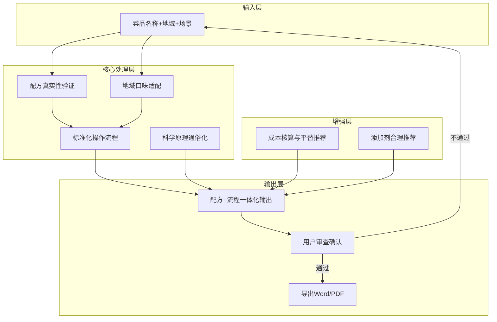

# 餐饮配方自动生成器 领域概览

> **核心理念**：输入菜品名称 → AI 自动输出经过科学验证的完整配方操作方案（配方+流程+注意事项+平替建议），确保真实性、可落地、符合当地习惯。
>
> **使用场景**：
> - 餐饮创业小白筹备开店，需要科学可靠的招牌菜配方
> - 中小餐饮店老板想上新菜或优化现有菜品口味
> - 厨师/夫妻店需要标准化操作流程，提升出餐质量一致性

---

## 1️⃣ 领域定义（Domain Definition）

### 领域基本信息

```yaml
domain_name: "餐饮配方自动生成器"
domain_id: "recipe-generator"
version: "0.1.0"
phase: "building"
created: "2026-05-24"
upstream_domains: []
downstream_domains: []
tags: ["餐饮配方", "科学验证", "标准化操作", "地域适配", "添加剂推荐", "B端餐饮"]
```

---

## 2️⃣ 领域使命（Domain Mission）

### 使命陈述

**帮中小B端餐饮用户（创业小白/中小店老板/厨师/夫妻店），输入菜品名称后，AI 自动输出经过科学联网验证的完整配方操作方案，确保配方真实、科学、可落地，符合当地饮食生活习惯。**

### 解决的问题

- 问题1：**用户无法判断配方真伪**——非食品科学专业出身，AI 生成的配方靠不靠谱，真实性有没有保障，完全不知道
- 问题2：**配方科学性无系统验证**——AI 可能杜撰配方比例、温度、时间，缺乏联网交叉验证机制
- 问题3：**光有配方不会操作**——知道原料和比例，但不知道操作步骤、先后顺序、关键节点判断标准，做出来不好吃甚至失败
- 问题4：**配方参数太模糊**——传统配方"少许、适量、大概"无法精确执行，批量出餐时每次味道都不一样
- 问题5：**配方不接地气**——不考虑用户所在地的口味偏好和饮食习惯，做出来当地人不买账

### 预期价值

- 价值1：单个菜品配方从查资料到做出成品，时间压缩到 30 分钟以内
- 价值2：配方科学准确率 100%（所有参数经过联网交叉验证）
- 价值3：配方可直接落地执行率 ≥ 90%（用户照着做就能成功）
- 价值4：配方符合当地口味适配准确率 ≥ 85%

---

## 3️⃣ 利益相关者（Stakeholders）

### 目标受众

| 角色 | 使用场景 | 知识水平 | 典型任务 |
|------|---------|---------|---------|
| **餐饮创业小白** | 筹备开店，需要招牌菜配方 | 零餐饮专业背景，完全依赖 AI | 输入菜名，拿到完整配方方案直接执行 |
| **中小餐饮店老板** | 已有店铺，想上新菜/优化口味 | 有实操经验，缺乏食品科学理论 | 输入想做的菜，验证配方是否靠谱，按流程上新 |
| **厨师** | 日常出餐，需要标准化配方 | 实操能力强，缺乏科学体系 | 输入菜名，拿标准化配方+操作流程，统一出餐质量 |
| **餐饮夫妻店** | 一人多岗，快速出餐 | 经验驱动，缺乏标准化能力 | 输入菜名，快速出配方，参照流程执行 |

### 使用流程

1. **输入菜品**：用户输入菜品名称（如"红烧肉"）+ 所在地区（如"四川绵阳"）+ 出餐场景（如"快餐/正餐/外卖"）
2. **AI 生成配方**：AI 联网搜索验证，生成包含配方参数+操作流程+注意事项的完整方案
3. **成本核算+平替检查**：检查原料成本，高价原料自动推荐平替方案
4. **添加剂合理性审查**：如有添加剂推荐，附带使用方法和安全注意事项
5. **用户审查确认**：用户审核配方真实性、科学性、地方适配性、成本合理性
6. **导出交付**：通过审查后，导出为 Word 或 PDF 格式

---

## 4️⃣ 核心概念（Core Concepts）

### 概念清单

#### 1. 配方真实性验证（Recipe Authenticity Validation）

**定义**：AI 生成配方后，自动联网搜索多个来源交叉验证配方参数（原料比例、温度、时间）的科学性和安全性，确保不杜撰、不出错。

**用途**：解决用户"无法判断配方真伪"的核心痛点，确保输出的配方可以放心使用。

**示例**：
- 生成"红烧肉"配方时，验证糖色炒制温度（180-200℃）是否准确
- 验证五花肉焯水时间（冷水下锅、水开后3-5分钟）是否符合食品安全标准
- 验证盐糖比例（盐≤2%，糖≤5%）是否在合理范围内

---

#### 2. 标准化操作流程（Standardized Operation Procedure）

**定义**：将配方拆解为精确到克/度/分钟的完整操作步骤，包括：原料准备→预处理→烹饪步骤→关键节点判断→成品标准。

**用途**：让零基础用户也能按步骤执行，实现"照着做就能成功"。

**示例**：
- ✅ 正确："五花肉 500g 切 3cm 见方，冷水下锅加姜片 15g、料酒 20ml，大火烧开后撇去浮沫，转中火焯 3 分钟，捞出沥干"
- ❌ 错误："五花肉适量，焯水后捞出备用"

---

#### 3. 地域口味适配（Regional Taste Adaptation）

**定义**：根据用户所在地区的饮食习惯，自动调整配方中的咸度、辣度、甜度、麻度、油量等参数，使配方更符合当地口味偏好。

**用途**：解决"配方不接地气"的问题，同一个菜在不同地区做出当地人喜欢的味道。

**示例**：
- 红烧肉：四川版加郫县豆瓣 30g + 干辣椒 10g → 咸辣回甜；江浙版只用冰糖 40g + 老抽 20ml → 咸甜软糯
- 麻婆豆腐：重庆版花椒粉 5g 出重麻；广式版花椒粉 1g 出轻麻

---

#### 4. 配方+流程一体化输出（Recipe + Process Integrated Output）

**定义**：输出内容不只包含配方比例，而是将"配方参数 + 操作流程 + 关键判断标准 + 常见错误避坑 + 成品标准"打包成一个完整方案。

**用途**：用户拿到手就能直接用，不需要再到处查资料、看视频补操作细节。

**示例**：
```
【配方】五花肉 500g | 冰糖 40g | 老抽 20ml | 生抽 30ml | 料酒 20ml | 姜 15g | 八角 2颗 | 桂皮 1小块 | 盐 5g
【操作】1. 五花肉切3cm块，冷水下锅加姜+料酒，水开焯3分钟捞出 → 2. 锅中小火，冰糖+油20ml，炒至枣红色冒泡 → 3. 下肉翻炒上色...
【关键节点】炒糖色：枣红色=刚好，深褐色=发苦失败
【避坑】焯水务必冷水下锅！热水下锅肉表面瞬间凝固，血水出不来，成品腥
【成品标准】肉块红亮、肥而不腻、筷子一夹即断但不散
```

---

#### 5. 科学原理通俗化（Scientific Principle Popularization）

**定义**：用通俗易懂的语言解释配方背后的食品科学原理（如美拉德反应、乳化作用、蛋白质变性），让用户不仅知道"怎么做"，还知道"为什么这么做"。

**用途**：提升用户对配方合理性的信任感，同时在操作失误时能自行判断问题出在哪个环节。

**示例**：
- 专业表述："利用美拉德反应在 140-165℃ 产生焦香风味物质"
- 通俗表述："糖在高温下会变成焦糖色，这时候肉下锅一炒就特别香，但温度太高糖会苦，看到枣红色冒小泡就是最佳时机"

---

#### 6. 用户审查确认（User Review & Confirmation）

**定义**：配方生成的关键步骤（原料清单确认→配方参数确认→操作流程确认→最终成品确认）每一步输出前，必须等待用户审核通过才能进入下一步。

**用途**：确保最终交付的配方方案经过人工校验，避免 AI 幻觉导致的配方错误。

**示例**：
- ✅ AI："以下是为您生成的'红烧肉'配方参数，请确认原料清单是否齐全？[展示配方表]"
- ❌ AI 直接输出完整方案不确认

---

#### 7. 成本核算与平替推荐（Cost Accounting & Substitute Recommendation）

**定义**：自动计算配方中各原料的预估成本，标记高价原料，并提供价格更低但风味相近的平替产品方案。

**用途**：帮助中小B端餐饮用户控制食材成本，在品质和成本之间找到最优解。

**示例**：
- 原料"干贝（瑶柱）" → 预估成本 180元/500g ⚠️高价 → 平替："淡干虾皮 30元/500g，鲜味接近，用量调整为瑶柱的1.5倍"
- 原料"藏红花" → 预估成本极高 → 平替："栀子黄色素 或 红曲米粉，上色效果相近，成本仅为1/50"

---

#### 8. 添加剂合理推荐（Food Additive Recommendation）

**定义**：在确保食品安全合规的前提下，推荐可适量使用、能显著提升菜品风味的食品添加剂，附带精确用量、使用方法、安全上限和注意事项。

**用途**：帮助用户在不牺牲食品安全的前提下，用合法添加剂提升菜品竞争力。

**示例**：
- 推荐："乙基麦芽酚 0.01%（即 500g 肉加 0.05g）——去腥增香，适用于红烧/卤制肉类"
  - 使用方法：先用少量温水（约 50ml）完全溶解后，在出锅前 5 分钟加入
  - ⚠️ 注意事项：严禁超量（苦味），不可与含铁容器接触，密封避光保存，孕期慎用
  - 安全上限：每日允许摄入量（ADI）为 0-2mg/kg 体重

---

### 概念关系



| 概念A | 关系类型 | 概念B | 说明 |
|-------|---------|-------|------|
| 配方真实性验证 | 前置依赖 | 标准化操作流程 | 只有验证通过的配方才能进入流程编排 |
| 地域口味适配 | 影响 | 标准化操作流程 | 地域参数决定配方中的咸/甜/辣/麻比例 |
| 标准化操作流程 | 组成 | 配方+流程一体化输出 | 流程是最终输出的核心骨架 |
| 成本核算与平替推荐 | 增强 | 配方+流程一体化输出 | 为用户提供成本维度的决策信息 |
| 添加剂合理推荐 | 增强 | 配方+流程一体化输出 | 可选增强项，提升菜品风味竞争力 |
| 科学原理通俗化 | 贯穿 | 配方+流程一体化输出 | 每个关键步骤都附带通俗原理说明 |
| 用户审查确认 | 把关 | 最终导出 | 所有关键步骤输出前必须用户确认 |

---

## 5️⃣ 领域边界（Domain Boundaries）

### 包含范围

- ✅ 配方参数生成：完整原料清单 + 精确用量（克/ml/度/分钟）
- ✅ 科学性联网验证：多来源交叉验证配方参数的科学性和安全性
- ✅ 标准化操作流程：从备料到成品的完整操作步骤 + 关键节点判断标准
- ✅ 地域口味适配：根据用户所在地区的饮食习惯自动调整配方参数
- ✅ 注意事项/避坑指南：每个关键步骤的常见错误标注和规避方法
- ✅ 成本核算与平替推荐：高价原料自动标记并推荐平价替代方案
- ✅ 添加剂合理推荐：可适量使用的食品添加剂，附带用量/方法/注意事项/安全上限
- ✅ 导出 Word / PDF：用户确认后导出为可打印、可保存的标准文档格式

### 排除范围

- ❌ 视频拍摄指导：不涉及短视频拍摄、剪辑、运镜等（属于另一领域）
- ❌ 供应链采购建议：不涉及原料在哪买、供应商选择（用户自行采购）
- ❌ 深度营养学分析：不涉及卡路里/碳水/蛋白质等详细营养成分计算
- ❌ 餐厅运营管理：不涉及人员管理、排班、营销、客户服务等
- ❌ 多平台内容发布：不涉及将配方发布到抖音/小红书等内容平台

### 与其他领域的关系

| 相关领域 | 关系类型 | 关系说明 |
|---------|---------|---------|
| 通俗切专业（tongsuqiezhuanye） | 互补 | 通俗切专业生成口播脚本用于内容传播，本领域生成配方方案用于后厨落地 |
| 规则生成器（rule-generator-v1） | 参考 | 参考 rule-generator-v1 的规则体系设计方法论 |

---

## 6️⃣ 演进路径（Evolution Path）

### 成熟度阶段

**当前阶段**：building（建设期）

### 版本规划

| 版本 | 阶段 | 主要目标 | 预计时间 |
|------|------|---------|---------|
| v0.1.0 | building | 完成领域概览+规则规划，搭建核心提示词框架 | 2026-Q2 |
| v0.5.0 | building | 完成首批配方生成测试（≥20 个菜品），优化核心规则 | 2026-Q3 |
| v1.0.0 | stable | 规则体系完善，配方质量稳定，开始小范围推广 | 2026-Q4 |

### 扩展空间

- 🔲 营养标签自动生成：为每个配方自动计算卡路里和营养成分表
- 🔲 季节菜单推荐：根据季节变化自动推荐应季菜品配方
- 🔲 过敏原提示：自动标注配方中的常见过敏原（花生/海鲜/乳制品等）
- 🔲 批量配方管理：支持用户管理自己的配方库，一键对比和优化

---

## 7️⃣ 核心规则（Core Rules）

### 规则1：配方科学真实性优先

**规则描述**：所有配方参数在输出前必须经过联网搜索交叉验证，至少 2 个以上独立来源确认，禁止 AI 凭训练数据杜撰。

**适用场景**：所有配方生成场景。

**示例**：
- ✅ 正确：生成"卤牛肉"配方时，验证香料的种类和用量、卤制时间、盐度
- ❌ 错误：AI 凭空编造一个"秘制卤料"比例，完全没有来源依据

---

### 规则2：精确可落地

**规则描述**：所有配方参数必须精确到可执行的最小单位（固体用克、液体用毫升、温度用℃、时间用分钟），禁止"少许、适量、大概"等模糊词汇。

**示例**：
- ✅ 正确："盐 5g，白糖 15g，酱油 20ml，中火（160℃）炒 3 分钟"
- ❌ 错误："盐少许，白糖适量，加点酱油炒一会儿"

---

### 规则3：用户审查确认

**规则描述**：配方生成的关键步骤每一步必须等待用户审核通过才能进入下一步。跳过任何一步确认的输出视为无效。

**示例**：
- ✅ 正确：每步展示阶段性成果 → 明确询问用户确认 → 等待回复后推进
- ❌ 错误：所有步骤一气呵成全部输出

---

### 规则4：添加剂安全合规

**规则描述**：推荐的任何食品添加剂必须在 GB 2760 允许范围内，附带精确用量、使用方法、安全上限、禁忌人群。禁止推荐任何违规添加剂。

**示例**：
- ✅ 正确："红曲米粉 0.2g/500g 肉（GB 2760 允许），用于上色，出锅前 10 分钟加入"
- ❌ 错误："加点嫩肉粉"（不指定种类、用量、安全上限）

### 约束条件

- 🚫 禁止杜撰配方——所有参数必须有来源依据
- 🚫 禁止超国标推荐添加剂——所有添加剂必须在 GB 2760 范围内
- 🚫 禁止跳过用户确认——必须走完整确认流程

---

## 8️⃣ 使用指南（Usage Guide）

### 快速开始

1. **提供输入信息**：告知 AI 你想做的菜品名称 + 所在地区 + 出餐场景
2. **确认原料清单**：AI 展示配方所需全部原料，你确认有无缺失/替换需求
3. **确认配方参数**：AI 展示精确用量+操作流程，你审核合理性和地方适配
4. **审查成本+添加剂**：检查高价原料平替建议，确认添加剂用量和安全
5. **导出交付**：确认无误后，导出为 Word 或 PDF 文件

### 典型场景

#### 场景1：餐饮创业小白做招牌菜

**场景描述**：零餐饮经验的小白想开快餐店，需要"红烧牛肉面"招牌配方。

**前置条件**：用户提供城市（郑州）、场景（快餐）、客单价（20-25元）

**操作步骤**：
1. 输入："我要做红烧牛肉面，在郑州开店，做快餐，客单价 20 左右"
2. AI 联网生成配方 → 展示原料清单 + 精确用量 → 等待确认
3. AI 生成标准化操作流程 + 关键节点判断标准
4. AI 成本核算 → 高价原料推荐平替
5. AI 添加剂安全性审查 → 附用法+安全说明
6. 用户审查确认 → 导出 Word/PDF

**预期结果**：20 分钟内拿到完整可执行配方方案。

---

#### 场景2：老厨师优化现有菜品

**场景描述**：10 年经验厨师想优化"鱼香肉丝"配方，感觉不够正宗。

**前置条件**：用户提供当前配方 + 所在地区（成都）

**操作步骤**：
1. 输入："我的鱼香肉丝配方 [附配方]，在成都，帮我排查问题"
2. AI 联网验证当前参数 + 成都正宗做法对比 → 定位问题
3. AI 给出优化建议 + 调整后的精确配方
4. 用户确认 → 输出优化版配方+流程方案

**预期结果**：精准定位问题，拿到科学验证的改良版配方。

---

#### 场景3：添加剂使用咨询

**场景描述**：用户想用"乙基麦芽酚"但不知道能不能用、怎么用。

**操作步骤**：
1. 输入："卤猪蹄能不能加乙基麦芽酚？怎么用？"
2. AI 查询 GB 2760 → 确认合法使用范围
3. AI 输出：精确用量、使用时机、溶解方法、安全上限、注意事项
4. 用户确认 → 整合进完整配方方案

**预期结果**：拿到添加剂使用的完整安全说明书。

---

## 9️⃣ 参考资源（References）

### 外部资源

- GB 2760 食品安全国家标准《食品添加剂使用标准》
- 《中国居民膳食指南》——营养素参考摄入量
- 各地菜系正宗做法权威资料（中国烹饪协会、地方饮食文化典籍）
- 食品科学原理（美拉德反应、蛋白质变性、乳化作用等）

### 版本历史

| 版本 | 日期 | 变更说明 |
|------|------|---------|
| v0.1.0 | 2026-05-24 | 初始版本，8 核心概念 + 4 核心规则 + 3 典型场景 |

---
