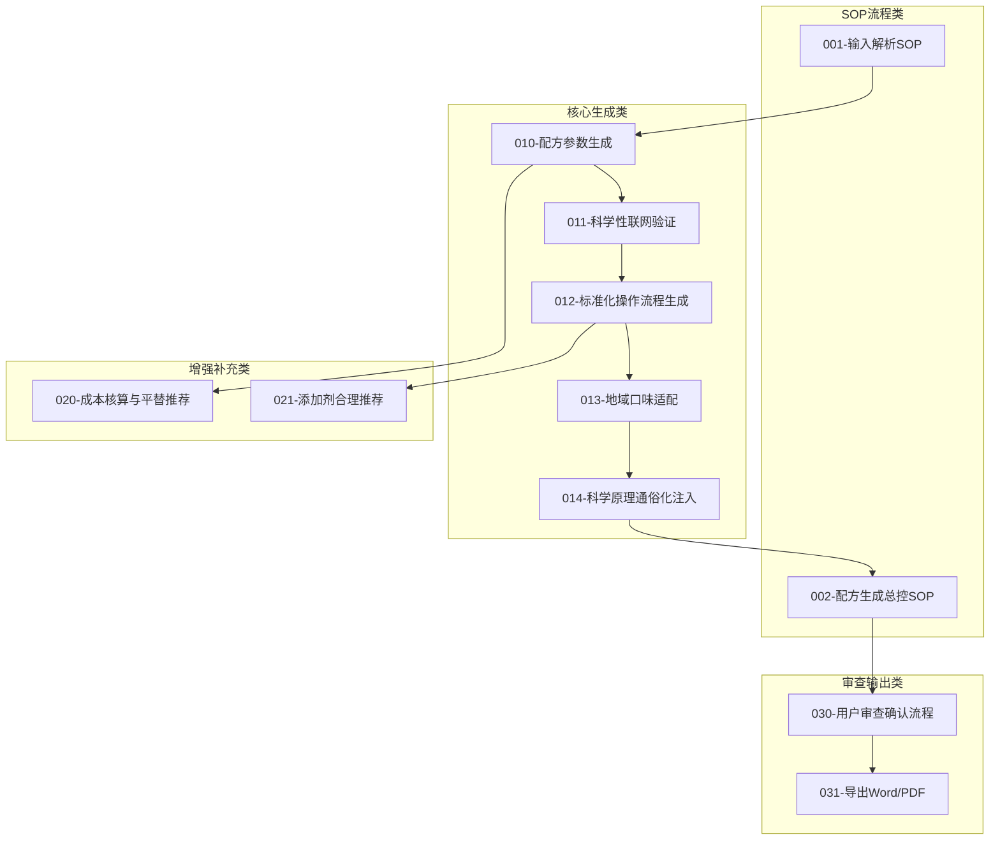
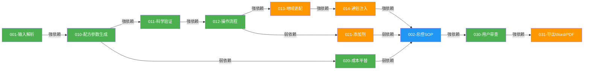

# 餐饮配方自动生成器 规则规划文档

> **核心理念**：基于 DAP 框架（Decomposition-Aggregation-Prioritization）系统性规划领域规则体系，覆盖从输入解析到导出交付的完整生命周期。
>
> **使用场景**：
> - Administrator 开发领域规则前，基于本规划文档执行
> - 中小B端餐饮用户通过标准化流程获取科学配方方案

---

## 1️⃣ 规划文档定义

```yaml
domain_name: "餐饮配方自动生成器"
domain_id: "recipe-generator"
version: "0.1.0"
phase: "building"
created: "2026-05-24"
upstream_domains:
  - domain-overview.md
tags: ["餐饮配方", "科学验证", "标准化操作", "规则规划"]
```

---

## 2️⃣ 规则体系概览

### 整体架构

本领域规则体系分为四大类别：

| 类别 | 说明 | 规则数量 |
|------|------|---------|
| **SOP流程类** | 定义标准化的配方生产全流程 | 2条 |
| **核心生成类** | 定义配方生成各环节的AI提示词 | 5条 |
| **增强补充类** | 定义成本控制和添加剂推荐规则 | 2条 |
| **审查输出类** | 定义用户审查和格式化导出规则 | 2条 |

### 规则架构图



---

## 3️⃣ 规则分类（Rule Decomposition）

### SOP流程类规则

| 规则ID | 规则名称 | 职责说明 | 对应核心概念 |
|:------:|----------|----------|-------------|
| 001 | 输入解析SOP | 解析用户输入的菜品名称、所在地区、出餐场景，标准化为后续处理的输入参数 | 配方+流程一体化输出 |
| 002 | 配方生成总控SOP | 定义完整配方生成流程的编排逻辑和各环节衔接规则 | 配方+流程一体化输出 |

### 核心生成类规则

| 规则ID | 规则名称 | 职责说明 | 对应核心概念 |
|:------:|----------|----------|-------------|
| 010 | 配方参数生成 | 生成菜品的完整原料清单和精确用量（克/ml），含配方总重和比例 | 配方+流程一体化输出 |
| 011 | 科学性联网验证 | 联网搜索多个来源交叉验证配方参数的科学性、真实性、安全性 | 配方真实性验证 |
| 012 | 标准化操作流程生成 | 生成从备料到成品的精确操作步骤（温度/时间/关键节点判断） | 标准化操作流程 |
| 013 | 地域口味适配 | 根据用户所在地区饮食习惯调整配方中咸/甜/辣/麻/油量参数 | 地域口味适配 |
| 014 | 科学原理通俗化注入 | 用通俗语言解释配方关键步骤背后的食品科学原理 | 科学原理通俗化 |

### 增强补充类规则

| 规则ID | 规则名称 | 职责说明 | 对应核心概念 |
|:------:|----------|----------|-------------|
| 020 | 成本核算与平替推荐 | 计算原料预估成本，标记高价原料并提供平替方案 | 成本核算与平替推荐 |
| 021 | 添加剂合理推荐 | 在GB 2760范围内推荐可提升风味的食品添加剂，附带用法和安全说明 | 添加剂合理推荐 |

### 审查输出类规则

| 规则ID | 规则名称 | 职责说明 | 对应核心概念 |
|:------:|----------|----------|-------------|
| 030 | 用户审查确认流程 | 定义关键步骤的用户审查节点和确认机制 | 用户审查确认 |
| 031 | 导出Word/PDF | 将审查通过的完整配方方案导出为标准文档格式 | 配方+流程一体化输出 |

---

## 4️⃣ 规则依赖关系（Rule Aggregation）

### 依赖关系表

| 规则ID | 前置依赖 | 输出给 | 依赖类型 |
|:------:|----------|--------|---------|
| 001 | 无 | 010 | 强依赖 |
| 002 | 014 | 030 | 弱依赖 |
| 010 | 001 | 011, 020 | 强依赖 |
| 011 | 010 | 012 | 强依赖 |
| 012 | 011 | 013, 021 | 强依赖 |
| 013 | 012 | 014 | 强依赖 |
| 014 | 013 | 002 | 强依赖 |
| 020 | 010 | 002 | 弱依赖 |
| 021 | 012 | 002 | 弱依赖 |
| 030 | 002 | 031 | 强依赖 |
| 031 | 030 | 最终用户 | 强依赖 |

### 依赖关系图（Mermaid）



> 绿色=P0，橙色=P1，蓝色=SOP流程

### 循环依赖检查

✅ 无循环依赖。

---

## 5️⃣ 开发优先级（Rule Prioritization）

### 优先级定义

| 优先级 | 判断依据 |
|:------:|----------|
| **P0** | MVP必须完成，直接支撑"输入菜品→输出配方"核心链路 |
| **P1** | 重要但非紧急，提升配方质量和用户信任 |

### 优先级清单

#### P0 规则（核心必需，6条）

| 规则ID | 规则名称 | 优先级依据 |
|:------:|----------|-----------|
| 001 | 输入解析SOP | 整个流程的入口，没有它后续规则无法启动 |
| 002 | 配方生成总控SOP | 编排全部规则执行顺序，核心调度器 |
| 010 | 配方参数生成 | 配方的核心产出物，用户最直接的交付价值 |
| 011 | 科学性联网验证 | 解决用户最大痛点"无法判断配方真伪" |
| 012 | 标准化操作流程生成 | 解决"光有配方不会做"的核心痛点 |
| 020 | 成本核算与平替推荐 | 直接关联B端用户经营成本和利润 |

#### P1 规则（重要但不阻塞 MVP，5条）

| 规则ID | 规则名称 | 优先级依据 |
|:------:|----------|-----------|
| 013 | 地域口味适配 | 提升配方本地化适配度，增强竞争力 |
| 014 | 科学原理通俗化注入 | 提升用户信任和操作理解力 |
| 021 | 添加剂合理推荐 | 增强配方风味竞争力，需谨慎对待安全合规 |
| 030 | 用户审查确认流程 | 保障交付质量，但可先手动确认再自动化 |
| 031 | 导出Word/PDF | 提升交付体验，但纯文本也能先用 |

### 开发阶段规划

| 阶段 | 目标 | 规则 | 验收标准 |
|------|------|------|---------|
| **Phase 1**（基础建设） | 跑通"输入菜品→配方+流程"核心链路 | 001, 010, 011, 012, 002 | 能用 AI 生成一个经科学验证的完整配方+操作流程 |
| **Phase 2**（质量提升） | 地域适配+成本控制+交付优化 | 013, 014, 020, 030, 031 | 配方本地化准确、成本可控、用户审查闭环跑通 |
| **Phase 3**（完善扩展） | 添加剂安全推荐+格式化交付 | 021 | 添加剂推荐在 GB 2760 范围内，附带完整安全说明 |

---

## 6️⃣ 概念覆盖度检查

| 核心概念 | 覆盖规则 | 覆盖状态 |
|----------|---------|:--------:|
| 1. 配方真实性验证 | 011 | ✅ |
| 2. 标准化操作流程 | 012 | ✅ |
| 3. 地域口味适配 | 013 | ✅ |
| 4. 配方+流程一体化输出 | 001, 002, 010, 031 | ✅ |
| 5. 科学原理通俗化 | 014 | ✅ |
| 6. 用户审查确认 | 030 | ✅ |
| 7. 成本核算与平替推荐 | 020 | ✅ |
| 8. 添加剂合理推荐 | 021 | ✅ |

**概念覆盖度：8/8 = 100%**

---

## 7️⃣ 典型应用场景

### 场景1：生成一个完整的新菜品配方

**涉及规则**：001 → 010 → 011 → 012 → 013 → 014 → 020 → 021 → 002 → 030 → 031

**执行流程**：
1. 001 解析用户输入："红烧肉 + 四川绵阳 + 正餐"
2. 010 生成完整原料清单和精确配方参数
3. 011 联网交叉验证配方参数的科学性
4. 012 生成从备料到成品的标准化操作流程
5. 013 根据四川口味调整咸辣甜比例
6. 014 为关键步骤注入通俗科学原理说明
7. 020 计算原料成本，标记高价原料并推荐平替
8. 021 检查是否有合适的添加剂推荐（附用法和安全说明）
9. 002 编排所有产出物，组装为完整配方方案
10. 030 用户逐步审查确认（原料→配方→流程→成本→添加剂）
11. 031 通过后导出为 Word/PDF

**预期结果**：20-30 分钟内拿到可直接落地执行的完整配方操作方案。

---

### 场景2：添加剂安全性咨询

**涉及规则**：001 → 010 → 011 → 021 → 030

**执行流程**：
1. 001 解析："卤猪蹄能否加乙基麦芽酚？"
2. 010 调用卤猪蹄配方参数作为上下文
3. 011 联网验证乙基麦芽酚在卤肉中的合规性
4. 021 生成添加剂推荐：精确用量/使用时机/溶解方法/安全上限/注意事项
5. 030 用户确认理解安全事项

**预期结果**：拿到添加剂使用的完整安全说明书。

---

## 8️⃣ 扩展空间

### 待开发规则

| 规则ID | 规则名称 | 预估价值 | 预计时间 |
|:------:|----------|---------|---------|
| 022 | 营养标签生成 | 满足健康饮食需求 | v0.5.0 |
| 023 | 过敏原自动标注 | 食品安全合规 | v0.5.0 |
| 024 | 季节菜单推荐 | 应季菜品运营 | v1.0.0 |
| 025 | 批量配方对比优化 | 配方库管理 | v1.0.0 |

### 跨领域扩展

- **短视频拍摄领域**：配方制作过程的拍摄脚本
- **供应链管理**：原料采购渠道和价格管理
- **餐厅数字化**：配方标准化→出餐SOP→点餐系统打通

---

## 9️⃣ 版本历史

| 版本 | 日期 | 变更说明 |
|------|------|---------|
| v0.1.0 | 2026-05-24 | 初始版本，基于 domain-overview 规划 4 类 11 条规则 |

---
